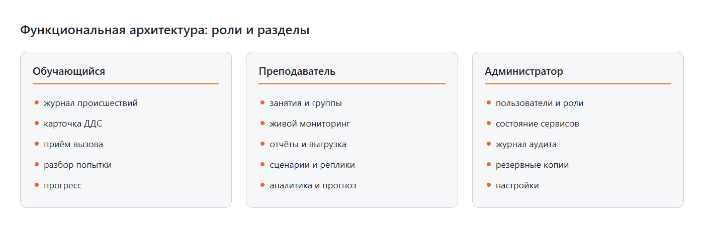

# Архитектура

Тренажёр диспетчера ДДС ставится на один сервер учебного класса. Рабочие места преподавателя и
обучающихся — компьютеры с браузером в той же сети. По умолчанию система работает в закрытом
контуре: модели ИИ, распознавание и синтез речи, проверка грамотности и телефония находятся на
сервере и не обращаются во внешние сети. Облачные части (модель для написания карточек,
облачный голос собеседников, SIP-линия оператора связи) подключаются только явной настройкой,
см. раздел «Контур без интернета».

## Функциональная архитектура

Система обслуживает три роли. Четвёртый участник — ИИ: он пишет карточки, играет собеседников
по телефону и оценивает действия. Схема работы, как её задал заказчик: **преподаватель и ИИ →
обучающийся → результат → рекомендации для дальнейшего обучения**.

**Обучающийся** (диспетчер ДДС) работает на копии АРМ-112: журнал происшествий, карточка ДДС с
виртуальным телефоном, разбор каждой карточки с советами, «Мои задания» и «Мой прогресс»,
справочник (памятка, методические материалы, классификатор).

**Преподаватель** ведёт группы и занятия, наблюдает за обучающимися во время занятия, смотрит
отчёты с выгрузкой в PDF, Excel и CSV, исправляет оценку с указанием причины, ведёт справочник
телефонов, библиотеку сценариев (с генерацией по фразе) и методические материалы, смотрит
аналитику группы и прогноз готовности.

**Администратор** ведёт пользователей и роли, службы, видит состояние сервисов с оповещениями,
журнал аудита с проверкой целостности, резервные копии и настройки (в том числе телефонии).

### Режимы занятий

**Реагирование на карточку (основной).** Карточка от оператора 112 приходит в журнал службы
обучающегося. Он принимает её («Принята») или отклоняет («Не принята» с причиной) в пределах
норматива, отмечает ошибки оператора 112 в данных карточки, по виртуальному телефону звонит
начальнику аварийной бригады, руководству и дежурным других служб, принимает доклады бригады,
ведёт ход работ статусами с номером наряда и комментарием и закрывает карточку.

**Приём вызова (оператор 112).** Обучающийся принимает звонок заявителя, роль которого играет
ИИ, и заполняет карточку: опросную карту признаков, адрес, флаги, описание. Службы для оповещения
подставляются по классификатору. По рекомендации заказчика режим скрыт: администратор открывает
его отдельным пользователям, сервер проверяет право доступа при создании занятий и сценариев
этого режима.

### Как подаются карточки

- **Из утверждённых сценариев.** Карточки берутся из библиотеки по сложности занятия, при
  включённом адаптивном подборе — из групп происшествий, где рейтинг обучающегося ниже.
- **«Задания формирует ИИ».** Каждому обучающемуся модель пишет свои карточки во время занятия
  по службе ДДС, выбранной в занятии: на сложности 1 — одну, на сложности 2 — две по очереди, на
  сложности 3 — вал из трёх. Следующая карточка пишется после оценки предыдущей с учётом её
  ошибок. Если модель не ответила вовремя, карточка собирается по шаблону.
- **Вал на сложности 3.** Первая карточка сразу, следующие по одной через 40–50 секунд, всего
  три; в обычном занятии среди них бывает повторный вызов о том же происшествии.

### Ход занятия

1. Преподаватель создаёт занятие (группа, способ подачи карточек, служба, сложность, норматив,
   порог зачёта, режим ответа собеседников, разрешение звонить заявителю) и начинает его.
2. Сервер выдаёт карточки в журнал обучающегося и рассылает события занятия.
3. Каждое действие обучающегося (статус, отметка ошибки, звонок, фраза разговора) пишется в базу
   с отметкой времени.
4. Фоновый цикл сервера следит за нормативом («Не оповещено»), выдаёт карточки вала и запускает
   доклады бригады.
5. После закрытия карточки движок оценки сравнивает действия с эталоном сценария и выдаёт разбор
   с баллом, ошибками и советами. Результат обновляет рейтинг навыка обучающегося.
6. Преподаватель видит ход занятия на плитках обучающихся, после занятия — отчёт, аналитику и
   прогноз.

## Компонентная архитектура

Все части запускаются в контейнерах Docker Compose.

**Браузер.** Интерфейс на React: эмулятор АРМ-112 с виртуальным телефоном, рабочее место
оператора 112, кабинеты. С сервером работает по HTTPS и WebSocket через nginx.

**nginx** завершает TLS (свой центр сертификации создаётся при первом запуске), отдаёт собранный
интерфейс, проксирует `/api` и `/ws` к бэкенду и `/ws/sip` к Asterisk. Задаёт заголовки
безопасности (CSP, HSTS).

**backend** (Python, FastAPI, один процесс uvicorn) содержит всю логику:

| Модуль | Что делает |
|---|---|
| `training` | занятия, выдача карточек, вал, доклады бригады, задания от ИИ, справочник телефонов, отчёты, события занятия |
| `dialog` | ход разговора с заявителем и с собеседниками диспетчера ДДС |
| `telephony` | клиент Asterisk (ARI), звук звонка, звонки в службы, облачный голос |
| `scenarios` | библиотека сценариев, генерация, утверждение, озвучка реплик |
| `domain/evaluation` | оценка действий, типичные ошибки, советы |
| `domain/analytics`, `analytics` | рейтинг навыка, адаптивный подбор, прогноз готовности |
| `providers` | доступ к моделям: языковая модель, распознавание и синтез речи, смысловая близость, грамотность, поиск по материалам |
| `admin`, `auth`, `reports` | пользователи, состояние, аудит, копии, вход, выгрузка отчётов |

Фоновая работа идёт внутри процесса бэкенда:

- цикл раз в 5 секунд выдаёт карточки вала, ставит «Не оповещено» и «Не завершено», запускает
  доклады бригады; расписание считается по отметкам времени в базе, а записи блокируются
  (`SKIP LOCKED`), поэтому перезапуск ничего не теряет;
- генерация сценариев, написание карточек для режима ИИ и озвучка реплик идут асинхронными
  задачами; состояние задач генерации хранится в Redis;
- монитор состояния сервисов раз в минуту открывает оповещения администратору.

Сервис `worker` (ARQ) запущен из того же образа и зарезервирован под вынос фоновых задач; сейчас
в нём только служебная проверка.

**Хранилища.** PostgreSQL 16 — пользователи, занятия, попытки, оценки, сценарии и их версии,
события занятия, журнал аудита. Redis — рассылка событий занятия между подключениями и
состояние задач генерации.

**Модели и речь** (профиль `ai`): языковые модели Qwen2.5 через сервер llama.cpp (`llm-dialog` —
собеседники, `llm-gen` — написание сценариев и карточек), распознавание речи faster-whisper
(`stt`). Синтез речи (Silero, Piper), смысловая близость (multilingual-e5) и определитель фраз в
звонке (Silero VAD) работают внутри бэкенда. LanguageTool проверяет грамотность.

**Телефония** (профиль `telephony`): Asterisk с PJSIP. Программный телефон в браузере
регистрируется по WebRTC через `/ws/sip`, настольный IP-телефон — по SIP на порт 5060. Бэкенд
управляет звонками через ARI: соединяет обучающегося с моделью, снимает его голос, проигрывает
ответы и пишет разговор.

### Сервисы Docker Compose

| Сервис | Профиль | Назначение |
|---|---|---|
| `nginx` | всегда | TLS, интерфейс, прокси к `/api`, `/ws`, `/ws/sip` |
| `backend` | всегда | API, WebSocket, занятия, разговоры, оценка, клиент телефонии, фоновый цикл |
| `worker` | всегда | ARQ, зарезервирован под фоновые задачи |
| `postgres` | всегда | база данных (образ с pgvector, векторные колонки не используются) |
| `redis` | всегда | события занятия, состояние задач генерации |
| `languagetool` | всегда | проверка грамотности текстов обучающегося |
| `backup` | всегда | ежесуточная копия базы данных |
| `llm-dialog` | `ai` | языковая модель собеседников |
| `llm-gen` | `ai` | языковая модель для сценариев и карточек |
| `stt` | `ai` | распознавание речи |
| `asterisk` | `telephony` | SIP, WebRTC, запись разговоров, ARI, SIP-транк оператора связи (по настройке) |
| `asterisk-cloud` | `cloud` | Asterisk с SIP-транком в облачный голосовой сервис; вместо `asterisk`, вместе не поднимаются |

Профили `live` и `monitoring` объявлены как заготовка под узел с видеокартой и под Prometheus с
Grafana и пока не содержат сервисов. Бэкенд уже отдаёт метрики по адресу `/api/metrics`.

**Поставка заказчику** (`start.sh` и установщик без интернета) поднимает профили `ai` и
`telephony` с настройками демонстрационного стенда: одна модель Qwen2.5-3B в `llm-dialog` ведёт и
разговоры, и написание карточек (сервис `llm-gen` не запускается), распознавание —
`faster-whisper-small`.

## Режимы ответа собеседников

Режим выбирается в занятии («Как отвечает заявитель» или «Как отвечают служба и бригада»):

| Режим | Где работает | Как устроен |
|---|---|---|
| Предзаписанные реплики | сервер | модель выбирает номер утверждённой реплики, текст не сочиняет; реплики озвучены заранее |
| Свободная генерация речи (без интернета) | сервер | модель отвечает своими словами по листу фактов, ответ озвучивается на сервере |
| Свободная генерация речи (с интернетом) | облако | весь разговор ведёт облачный голосовой сервис; сервер даёт ему факты и роль, после звонка читает запись и анкету |

Облачный режим предлагается только при включённом облачном голосе. Если облако не ответило за
15 секунд или звонок оборвался, разговор продолжает локальная модель в режиме предзаписанных
реплик. Без модели диалога ответы подбираются по ключевым словам, в приёме вызова появляются
кнопки тем. Подробности — [METHODS.md](METHODS.md), раздел 6.

## Голосовой тракт

**Браузер без телефонии (основной путь).** Обучающийся держит кнопку «Удерживайте и говорите»
(или включает микрофон в приёме вызова), браузер записывает фразу и отправляет её по HTTPS.
Сервер распознаёт речь, получает ответ собеседника и отдаёт его звуковым файлом. Можно отвечать
и текстом.

**Через Asterisk.** Телефония включается не для всего сервера, а для занятия: галочкой «Живой
звонок на телефон» с номером телефона. Галочка доступна, только если включена телефония и
настроена SIP-линия оператора связи (в форме — для приёма вызова с облачным голосом). Тогда
вызовы занятия приходят на указанный обычный телефон. Без номера занятия Asterisk звонит на
программный телефон в браузере (WebRTC) и на настольный IP-телефон обучающегося (SIP). Для
локальных моделей Asterisk передаёт голос обучающегося на сервер по RTP, сервер режет поток на
фразы (Silero VAD, при его отсутствии — по громкости), распознаёт каждую фразу, выбирает ответ и
проигрывает его в звонок. Разговор записывается целиком. В остальных занятиях голос идёт через
браузер, как описано выше.

**Облачный голос.** Браузер соединяется с облачным сервисом напрямую через его библиотеку, или
звонок идёт по SIP через `asterisk-cloud`. Сервер передаёт облаку роль и факты карточки (факты
не попадают в браузер), принимает события звонка по защищённому адресу с секретом и сохраняет
запись разговора у себя.

## Данные

| Что | Где |
|---|---|
| Пользователи, группы, занятия, попытки, действия, оценки, исправления оценок | PostgreSQL |
| Справочники заказчика: классификатор, службы, статусы, причины отказа, улицы Москвы | PostgreSQL, загружаются при первом запуске из `data/seed` и файлов заказчика |
| Сценарии и их версии | PostgreSQL, тело сценария в JSONB |
| Справочник телефонов служб | PostgreSQL |
| События занятия | PostgreSQL (с порядковым номером) и рассылка через Redis |
| Журнал аудита | PostgreSQL, цепочка контрольных сумм, у роли приложения нет права изменять и удалять записи |
| Методические материалы для поиска при генерации | текст в томе `storage`, индекс строится в памяти бэкенда при запуске |
| Озвученные реплики, студийные записи, записи разговоров | том `storage` |
| Резервные копии базы | том `backups` |
| Модели ИИ | папка `models` (не в git), подключается только на чтение |

Отчёты не хранятся: PDF, Excel и CSV собираются по запросу.

## Контур без интернета

- Модели скачиваются один раз (`scripts/fetch_models.sh`) и проверяются по контрольным суммам
  из `scripts/models.manifest`.
- Для сервера без интернета `scripts/offline_bundle.sh --with-models` собирает поставку: образы
  Docker, исходный код, модели, файлы заказчика, установщик и контрольные суммы. Установщик
  проверяет суммы, загружает образы и запускает систему, ничего не скачивая.
- При запуске бэкенд проверяет адреса моделей (`LLM_DIALOG_URL`, `LLM_GEN_URL`, `STT_URL`) и
  облачный голос: если адрес не локальный или облачный голос включён, а `ALLOW_EXTERNAL_AI` не
  равен `true`, система не запускается и сообщает причину.
- SIP-линия оператора связи для звонков на обычный телефон по умолчанию выключена и
  включается только заполнением её настроек.
- Шрифты и библиотеки интерфейса входят в сборку, внешних запросов из браузера нет. Только при
  включённом облачном голосе nginx разрешает в CSP адреса облачного сервиса.
- Служебные порты (база, Redis, модели, ARI) открыты только на самом сервере. Наружу смотрят
  HTTPS (443), HTTP (80) и, при телефонии, SIP и диапазон голосовых портов.

На демонстрационном стенде включены облачная модель для написания карточек и облачный голос;
код при этом тот же.

## Масштабирование

**Вертикальное.** Больше ядер и памяти ускоряют модели и позволяют вести больше одновременных
голосовых разговоров. Замеры — [PERFORMANCE.md](PERFORMANCE.md).

**Вынос моделей.** Модели и распознавание речи выносятся на отдельный узел той же сети: их
адреса задаются переменными окружения, код не меняется. Распознавание совместимо с
OpenAI-интерфейсом транскрипции, поэтому его можно заменить сервером на видеокарте.

**Несколько экземпляров бэкенда.** Часть состояния уже вынесена из процесса: события занятия
идут через базу и Redis и догоняются по номеру, расписание вала и докладов считается по базе с
блокировкой записей, задачи генерации хранят состояние в Redis. Но активные звонки Asterisk и
облачного голоса, а также идущие задачи генерации живут в памяти одного процесса, поэтому при
телефонии бэкенд запускается в одном экземпляре.

## Надёжность

- У сервисов есть проверки работоспособности, контейнеры перезапускаются при падении
  (`restart: unless-stopped`). Администратор видит состояние сервисов и получает оповещения.
- При недоступной модели занятие не останавливается: карточка ИИ собирается по шаблону,
  собеседник отвечает по ключевым словам, облачный звонок переходит на локальную модель, оценка
  без LanguageTool пересчитывается без грамотности.
- Копия базы делается ежесуточно в заданное время, хранится заданное число копий, копию можно
  создать вручную. Восстановление проверяется скриптом `scripts/restore_test.sh`: он разворачивает
  копию в отдельную базу и проверяет вход, чтение таблиц и цепочку аудита. Записи разговоров и
  озвучка (том `storage`) в копию базы не входят и копируются вместе с сервером.
- Обрыв связи не приводит к потере данных: события занятия догоняются по порядковому номеру,
  черновик карточки приёма вызова хранится в браузере и на сервере, отправка карточки и смена
  статусов идемпотентны; черновик статуса в карточке ДДС хранится в браузере.
- Журнал аудита связан цепочкой контрольных сумм, проверка цепочки запускается из кабинета
  администратора.

## Безопасность

- Доступ по ролям с проверкой владельца объекта на стороне сервера; режим оператора 112 —
  отдельное право пользователя.
- Пароли хранятся в виде хешей Argon2, после 5 неудачных попыток вход закрывается на 15 минут.
  Короткоживущий токен доступа передаётся в заголовке, токен продления — в защищённой cookie.
- Трафик браузера идёт по HTTPS, программный телефон — по защищённому WebRTC. Настольные
  IP-телефоны работают по обычному SIP внутри локальной сети.
- SIP-пароли обучающихся хранятся в базе в зашифрованном виде.
- Персональные данные минимальны: в списках показываются инициалы, показ ФИО — отдельное
  действие, которое пишется в журнал аудита. Все происшествия и заявители учебные.
- Внешние обращения запрещены конфигурацией: без явного разрешения `ALLOW_EXTERNAL_AI` система с
  внешним адресом модели или облачным голосом не запускается.
- Вход в один клик и таблица логинов на странице входа нужны только для демонстрации и
  выключаются настройками `QUICK_LOGIN` и `SHOW_DEMO_CREDENTIALS`.
