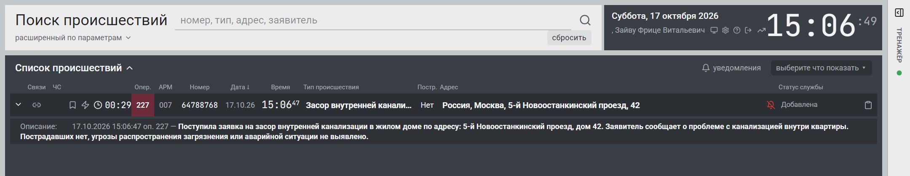
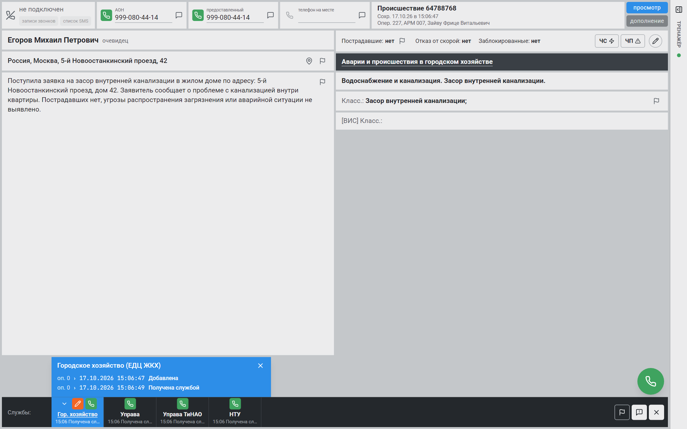
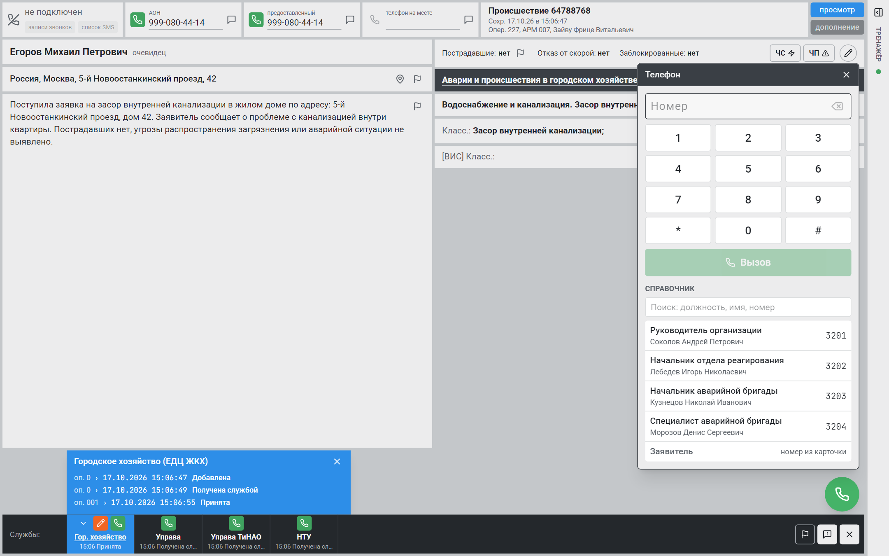

# Руководство пользователя

Краткий обзор: кто работает в тренажёре, какие у него экраны и как проходит занятие. Подробные
инструкции — в четырёх отдельных документах (PDF в папке `docs/submission`, исходный текст в
`docs/guides`):

| Документ | Для кого |
|---|---|
| «Ультратех_задача9_1_Общее_техническое_описание.pdf» ([guides/TECH_DESCRIPTION.md](guides/TECH_DESCRIPTION.md)) | назначение, функции, установка, настройка, неисправности |
| «Ультратех_задача9_2_Руководство_администратора.pdf» ([guides/ADMIN_GUIDE.md](guides/ADMIN_GUIDE.md)) | администратор |
| «Ультратех_задача9_3_Руководство_преподавателя.pdf» ([guides/TEACHER_GUIDE.md](guides/TEACHER_GUIDE.md)) | преподаватель |
| «Ультратех_задача9_4_Руководство_обучаемого.pdf» ([guides/STUDENT_GUIDE.md](guides/STUDENT_GUIDE.md)) | обучаемый, диспетчер ДДС |

## 1. Роли

| Роль | Что делает | Меню |
|---|---|---|
| Обучаемый (в интерфейсе «Обучающийся») | Работает диспетчером ДДС на копии АРМ-112: принимает карточки, звонит по виртуальному телефону, ведёт статусы, читает разбор и советы | «Мои задания», «Прогресс», «Справочник» |
| Преподаватель | Собирает группы, создаёт и проводит занятия, наблюдает, смотрит отчёты и аналитику, ведёт справочник телефонов, сценарии и методические материалы | «Занятия», «Группы», «Аналитика», «Сценарии», «Справочник телефонов» |
| Администратор | Заводит пользователей, следит за состоянием системы, журналом аудита, резервными копиями и настройками. Оценки, занятия и сценарии не меняет | «Пользователи», «Службы», «Состояние», «Аудит», «Копии», «Настройки» |

Карточки обучаемому пишет ИИ, если преподаватель включил это в занятии. ИИ же играет
собеседников по телефону; оценку и советы система строит автоматически по правилам памятки
заказчика.

## 2. Вход

Откройте адрес системы в браузере (Chrome, Яндекс.Браузер или Firefox). На странице «112 ВХОД В
СИСТЕМУ» введите логин и пароль и нажмите «ВОЙТИ». Для звонков нужна гарнитура с микрофоном.

После установки созданы пользователи `admin`, `teacher`, `student` и второй обучаемый `student2`
с паролем `112112112` (задаётся настройкой `SEED_PASSWORD`). На демонстрационном сервере под
формой входа показана таблица логинов и паролей по ролям и кнопки «Войти»; у заказчика она
выключается настройками.
Если администратор выдал временный пароль, при первом входе система попросит сменить его.
После пяти неверных паролей подряд вход закрывается на 15 минут.

Справа в шапке кабинета — имя, переключатель светлой и тёмной темы и кнопка «Выйти».

## 3. Режимы занятия

| Режим | Кто работает | Как идёт |
|---|---|---|
| Реагирование на карточку (ДДС) — основной | Диспетчер ДДС | Карточка от оператора 112 приходит в журнал службы. Диспетчер ставит «Принята» или «Не принята», звонит бригаде и руководству, принимает доклады, ведёт статусы и закрывает карточку |
| Приём вызова (оператор 112) — дополнительный | Оператор 112 | Звонит заявитель, его играет ИИ. Оператор ведёт опрос, заполняет адрес, тип происшествия, опросную карту и службы. Режим скрыт; администратор открывает его пользователям галочкой «Режим 112» |

Карточки ДДС подаются одним из двух способов:

- **«Задания формирует ИИ»** — ИИ пишет каждому обучаемому свои карточки по выбранной службе
  ДДС и подбирает следующую под его ошибки. У разных обучаемых разные происшествия;
- **из готовых сценариев** — карточки берутся из утверждённых сценариев библиотеки.

| Сложность | Что получает обучаемый |
|---|---|
| 1 | Простое бытовое происшествие, данные карточки верные, собеседники понятливые. Одна карточка |
| 2 | В карточке одна ошибка оператора 112, которую нужно найти. Одна карточка, в режиме ИИ — две по очереди |
| 3 | Чрезвычайные ситуации, две ошибки в карточке, собеседники торопят, бывает «машин нет» или осложнение на месте. Вал: первая карточка сразу, дальше по одной каждые 40–50 секунд, всего три |

## 4. Обучаемый

**Мои задания.** После входа открывается список занятий: активное сверху, кнопка «Открыть
журнал АРМ-112» открывает рабочее место.

**Журнал происшествий.** Карточки своей службы, новые сверху. Слева у строки таймер норматива:
первичный статус нужно поставить за 30 секунд (по умолчанию), иначе «Не оповещено».
Чрезвычайная ситуация отмечена молнией в колонке «ЧС». Значок у часов открывает «Мой прогресс».
Справа узкая панель «Тренажёр» — служебная, с подсказками, если их включил преподаватель.

**Карточка.** Слева заявитель, адрес и описание, справа признаки и тип, внизу полоса служб. На
вкладке своей службы оранжевый карандаш ставит статус (`Alt+A` — «Принята», `Alt+R` — «Не
принята»), зелёная трубка звонит начальнику аварийной бригады. Поля карточки не меняются, но
ошибку оператора 112 можно отметить кнопкой с флажком рядом с полем. Ход работ: «Начало
реагирования» с номером наряда, «Прибытие», «Проведение работ», «Работы завершены» с
комментарием — каждый после доклада бригады.

**Виртуальный телефон.** Зелёный кружок в правом нижнем углу карточки: клавиатура, справочник
номеров своей организации и последние вызовы. Собеседники: руководитель организации, начальник
отдела реагирования, начальник и специалист аварийной бригады; трубки на вкладках других служб
звонят их дежурным. Начальник бригады выезжает и называет номер наряда, как только узнал адрес
и что случилось, потом бригада сама звонит с докладами. Распоряжение «Выезжайте» нужно дать
самому, иначе в разборе ошибка «Не дано распоряжение на выезд». Заявителю можно позвонить,
только если это разрешил преподаватель. Говорить — удерживая кнопку «Удерживайте и говорите»,
или писать текстом.

**Разбор.** После закрытия карточки: балл и «Зачтено» или «Не зачтено», составляющие оценки,
до пяти советов, эталон против решения, ошибки словами памятки со ссылкой на страницу, проверка
данных карточки, звонки с расшифровкой. Если карточку написал ИИ, объяснено, почему выдана она.

**Прогресс и справочник.** «Прогресс» — динамика, рейтинг по группам происшествий, занятия с
советами, частые ошибки и рекомендации. «Справочник» — памятка «Работа на АРМ-112»,
методические материалы преподавателя и классификатор с поиском.

Подробно, со всеми статусами, звонками и типичными ошибками, — «Руководство обучаемого».

## 5. Преподаватель

1. **Группы** — «Создать группу», отметить обучаемых.
2. **Справочник телефонов** — номера людей организации по службам, до 10 на службу.
3. **Занятие** — «Занятия» → «Создать занятие»: группа, как отвечают служба и бригада,
   «Задания формирует ИИ» или готовые сценарии, служба ДДС, сложность, норматив, порог зачёта
   (по умолчанию 70), подсказки, «Разрешить звонок заявителю». Затем «Начать занятие».
4. **Наблюдение** — плитка на каждого обучаемого: что делает, таймер, баллы; щелчок открывает
   его текущую карточку. Красная рамка — просрочка норматива.
5. **Завершение и отчёт** — «Завершить занятие», «Отчёт»: итоги, таблица по обучаемым, действия
   по шагам, советы по занятию, выгрузка PDF, XLSX, CSV. В разборе карточки можно оставить
   комментарий и изменить оценку с причиной.
6. **Аналитика** — тепловая карта по группам происшествий, динамика по неделям, типичные ошибки
   группы, прогноз готовности к аттестации и страница «Достоверность прогноза».
7. **Сценарии** — библиотека, генерация сценария по фразе, проверка, утверждение, архив,
   методические материалы.

Занятие, которое не идёт, можно удалить вместе с его историей: «Занятия», отметить,
«Удалить выбранные». Подробно — «Руководство преподавателя».

## 6. Администратор

- **Пользователи** — создать, задать роль и службу обучаемого, сбросить пароль, заблокировать,
  открыть режим оператора 112 («Режим 112»), учётная запись настольного IP-телефона (нужна
  только для занятий с живым звонком на телефон). ФИО
  скрыто, каждый показ записывается в аудит.
- **Службы** — какие службы получают карточки через АРМ-112 и какие не могут отказать.
- **Состояние** — сервисы, нагрузка, активные занятия и звонки, оповещения о сбоях.
- **Аудит** — кто, что и когда делал; «Проверить целостность» подтверждает, что записи не
  изменялись.
- **Копии** — ежедневная копия базы и копия вручную.
- **Настройки** — ожидание ответа на вызов, запись разговоров, телефоны обучаемых, резервные
  копии, порог «Не завершено», уровень журнала.

Подробно — «Руководство администратора», установка и неисправности — «Общее техническое
описание».

## 7. Если что-то не работает

| Что видно | Что делать |
|---|---|
| Обучаемый не видит карточек | Он должен быть в группе занятия, занятие запущено, у него указана служба. В режиме ИИ подождите: на плитке «ИИ пишет карточку» |
| Собеседник не слышит | Разрешите микрофон в адресной строке браузера, проверьте гарнитуру; можно писать текстом |
| Собеседник отвечает невпопад | Говорите короче и ближе к микрофону. Преподаватель видит расшифровку и может исправить оценку |
| Не получается войти | Проверьте логин и пароль; после пяти ошибок подождите 15 минут или попросите администратора сбросить пароль |
| Статус не ставится | В списке «Статус» только те статусы, которые можно поставить следующими; после «Работы завершены» карточка закрыта |
