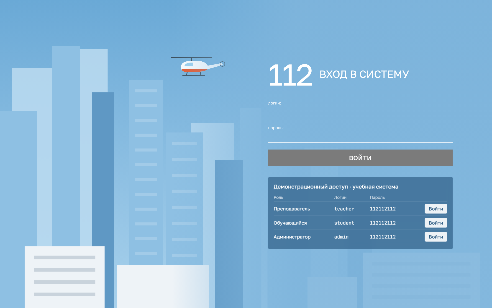
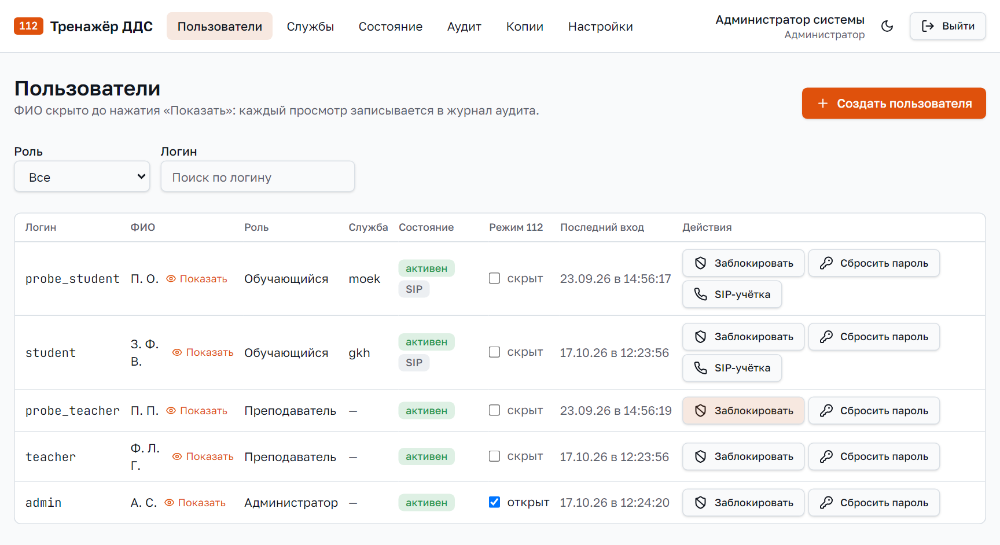
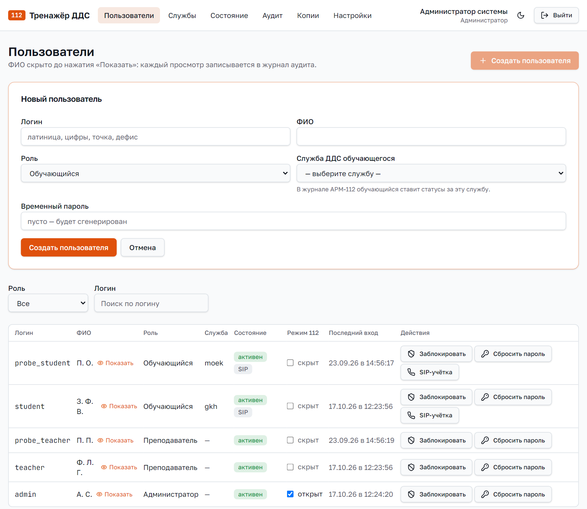
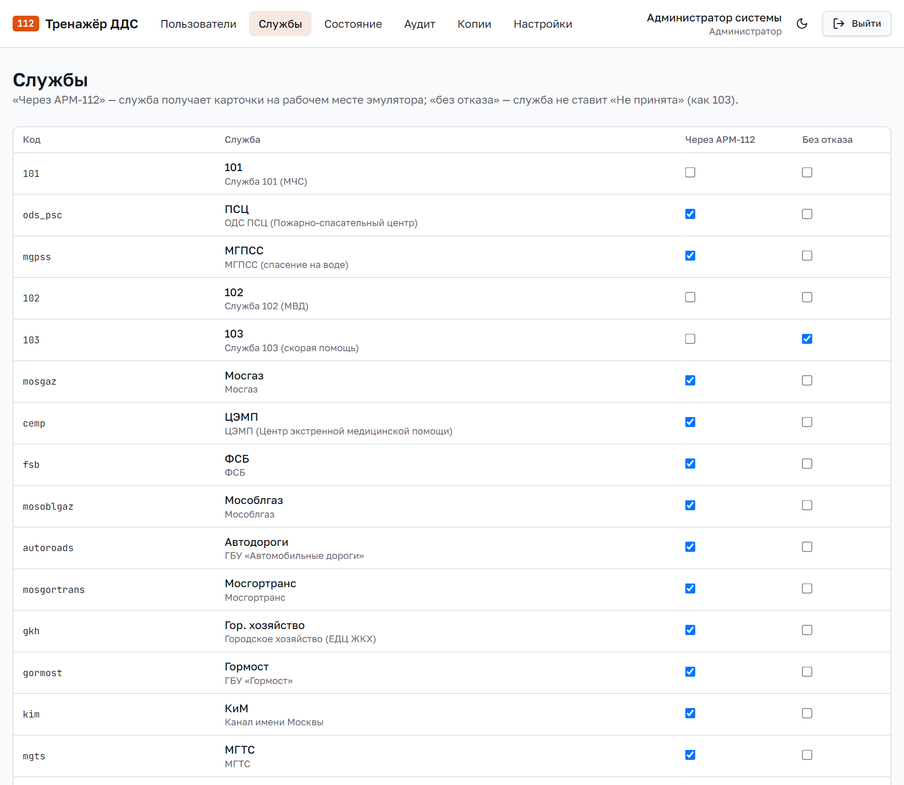
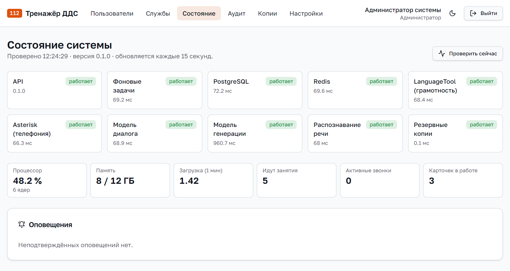
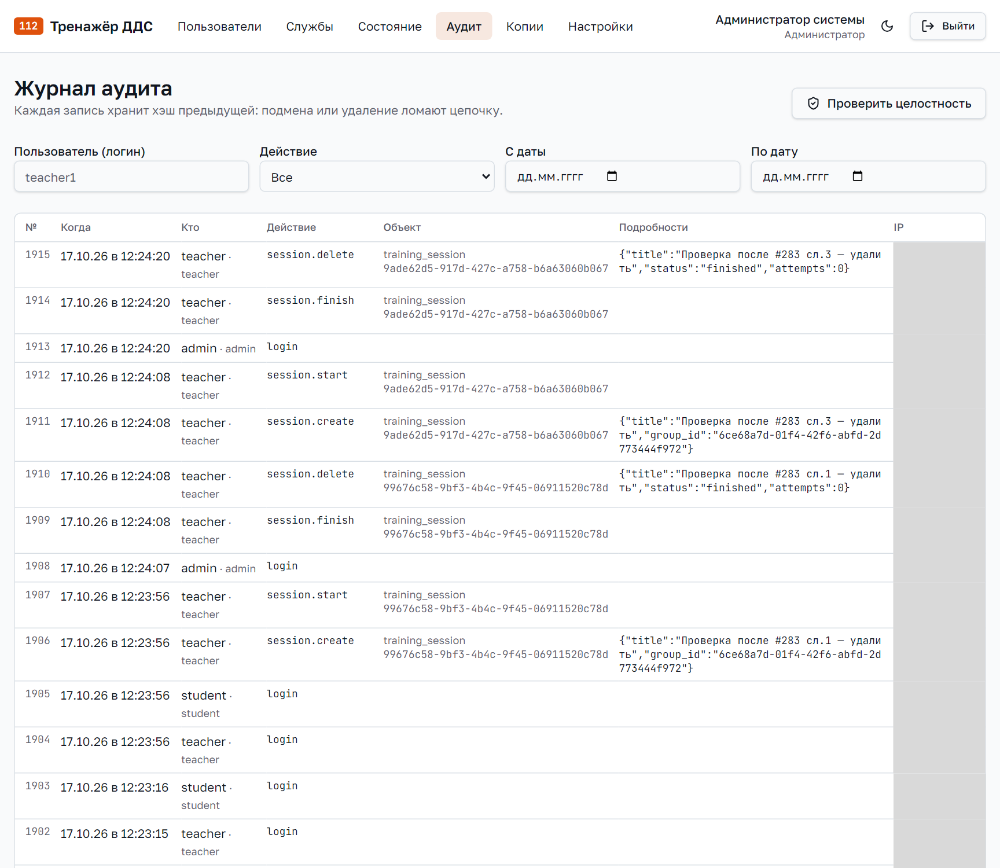
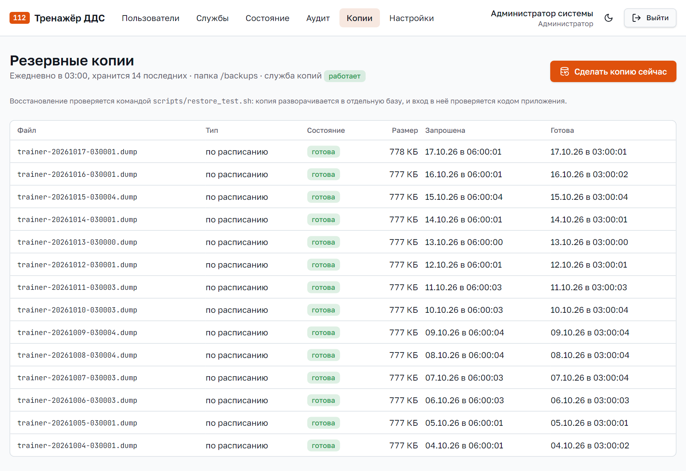
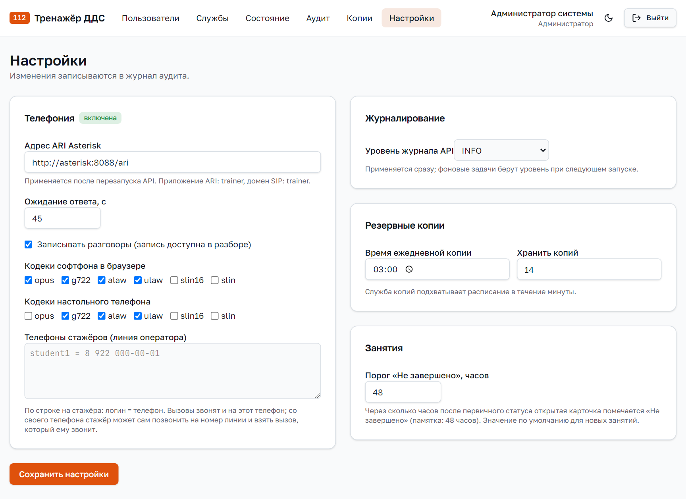

# Руководство администратора

## 1. Что делает администратор

Администратор отвечает за то, чтобы система работала и в неё могли войти нужные люди:

- заводит пользователей, выдаёт и сбрасывает пароли, блокирует;
- следит за состоянием сервисов и нагрузкой;
- смотрит журнал аудита: кто, что и когда делал;
- управляет резервными копиями;
- меняет настройки телефонии, журнала и занятий.

Оценки обучаемых, занятия и сценарии администратор не меняет: это зона преподавателя. Так
сделано специально, чтобы результаты обучения мог править только тот, кто ведёт занятие.

Установка и настройка сервера описаны в документе «Общее техническое описание», разделы 6 и 7.

## 2. Вход

Откройте адрес системы в браузере. На странице «112 ВХОД В СИСТЕМУ» введите логин и пароль и
нажмите «ВОЙТИ».



После установки администратор входит под логином `admin` с паролем из настройки
`SEED_PASSWORD` (по умолчанию `12345678`). При первом входе система попросит сменить пароль.

На демонстрационном стенде под формой входа показана таблица с логинами и паролями всех ролей и
кнопки «Войти». У заказчика эта таблица выключена настройкой `SHOW_DEMO_CREDENTIALS=false`.

После входа сверху видно меню администратора: «Пользователи», «Службы», «Состояние», «Аудит»,
«Копии», «Настройки». Справа — имя, переключатель светлой и тёмной темы и кнопка «Выйти».

## 3. Пользователи



В таблице по каждому пользователю: логин, ФИО, роль, служба, состояние, режим 112, время
последнего входа и кнопки действий. Сверху фильтр по роли и поиск по логину.

**ФИО скрыто.** Вместо фамилии видны инициалы. Полное ФИО откроется по ссылке «Показать», и
каждый такой просмотр записывается в журнал аудита. Так защищены персональные данные.

### 3.1. Создать пользователя

1. Нажмите «Создать пользователя».
2. Заполните поля:
   - **Логин** — латиница, цифры, точка, дефис, например `ivanov.dds`;
   - **ФИО**;
   - **Роль** — «Обучающийся», «Преподаватель» или «Администратор»;
   - **Служба ДДС обучающегося** — только для обучаемого: за эту службу он ставит статусы в
     журнале, например «Гор. хозяйство»;
   - **Временный пароль** — можно оставить пустым, система придумает сама.
3. Нажмите «Создать пользователя» внизу формы.



Система один раз покажет логин и временный пароль. Передайте их пользователю. При первом входе
он сменит пароль на свой.

### 3.2. Сбросить пароль

Если пользователь забыл пароль, нажмите «Сбросить пароль» в его строке. Система покажет новый
временный пароль, при входе пользователь сменит его.

### 3.3. Заблокировать

«Заблокировать» закрывает пользователю вход, его результаты при этом сохраняются. «Разблокировать»
возвращает доступ.

Отдельно система сама закрывает вход на 15 минут после пяти неверных паролей подряд. Ждать не
обязательно: можно сбросить пароль.

### 3.4. Учётная запись телефона

У обучаемых есть кнопка «SIP-учётка». Она показывает логин, пароль и адрес для настольного
IP-телефона. Звонки из браузера работают и без этого: учётная запись создаётся вместе с
пользователем.

### 3.5. Режим 112

Режим оператора 112 по умолчанию скрыт. Чтобы открыть его пользователю, поставьте галочку в
колонке «Режим 112» его строки.

## 4. Службы



Список служб из классификатора заказчика. У каждой две галочки:

- **Через АРМ-112** — служба получает карточки на рабочем месте тренажёра. Обучаемому
  назначайте службу с этой галочкой;
- **Без отказа** — служба не может поставить «Не принята», как служба 103.

Менять эти галочки нужно редко: значения по умолчанию взяты из памятки заказчика.

## 5. Состояние системы



Страница обновляется каждые 15 секунд, кнопка «Проверить сейчас» обновляет сразу.

**Плитки сервисов.** У каждой части системы статус: «работает», «не отвечает» или «не настроено»
и время отклика. Плитки: API, фоновые задачи, база данных PostgreSQL, Redis, проверка
грамотности LanguageTool, телефония Asterisk, модель диалога, модель генерации, распознавание
речи, резервные копии.

**Нагрузка и активность.** Загрузка процессора, занятая память, сколько идёт занятий,
активных звонков и карточек в работе.

**Оповещения.** Если сервис перестал отвечать, здесь появится оповещение. Разберитесь с причиной
и нажмите «Подтвердить». Что делать при каждом сбое — в документе «Общее техническое описание»,
раздел 8.

## 6. Журнал аудита



В журнал попадают важные действия всех пользователей: вход и неудачные попытки входа, запуск,
завершение и удаление занятий, действия обучаемых в карточке, изменение оценок преподавателем,
просмотр ФИО, сброс паролей, изменение настроек, создание копий.

По каждой записи видно: номер, время, кто, действие, объект, подробности и адрес компьютера.
Записи можно отобрать по логину пользователя, действию и датам.

**Проверить целостность.** Каждая запись хранит контрольную сумму предыдущей. Если кто-то
изменит или удалит запись прямо в базе, цепочка порвётся, и проверка это покажет. Через
программу записи журнала изменить или удалить нельзя.

## 7. Резервные копии



Система каждый день сама делает копию базы данных. Сверху видно расписание, сколько копий
хранится и работает ли служба копий. Старые копии удаляются автоматически.

**Сделать копию сейчас** — например, перед обновлением системы. Копия появится в списке со
статусом «в очереди», потом «готова».

В таблице: имя файла, тип («по расписанию» или «вручную»), состояние, размер, время запроса и
готовности.

**Проверка восстановления.** На сервере в папке установки выполните:

```bash
./scripts/restore_test.sh
```

Скрипт развернёт свежую копию в отдельную базу и проверит, что в неё можно войти. Рабочая база
при этом не меняется.

**Восстановление из копии** (выполняет администратор сервера):

```bash
docker compose stop backend worker
docker compose exec -T backup pg_restore --clean --if-exists --no-owner -d trainer /backups/<имя файла>.dump
docker compose start backend worker
```

Копия содержит базу данных: пользователей, занятия, результаты, журнал аудита. Записи
разговоров и озвученные реплики хранятся отдельно. Их копия:

```bash
docker compose cp backend:/storage ./storage-copy
```

## 8. Настройки



Все изменения записываются в журнал аудита. После правки нажмите «Сохранить настройки».

**Телефония:**

- адрес управления телефонией и время ожидания ответа — менять не нужно, если телефония
  работает;
- «Записывать разговоры» — запись слышна в разборе попытки;
- кодеки для браузера и для настольного телефона;
- телефоны стажёров — по строке на обучаемого: `логин = телефон`. Нужно, только если звонки
  выводятся на настоящие телефоны через внешнюю линию.

**Журналирование:** уровень подробности журнала сервера. Обычно `INFO`, для поиска ошибки —
`DEBUG`.

**Резервные копии:** время ежедневной копии и сколько копий хранить. Служба копий подхватывает
изменения в течение минуты.

**Занятия:** порог «Не завершено» в часах. Если обучаемый поставил первичный статус, но не
закрыл карточку за это время, карточка помечается «Не завершено». По памятке заказчика 48
часов. Это значение по умолчанию для новых занятий.

## 9. Если что-то не работает

| Что видно | Что сделать |
|---|---|
| Пользователь не может войти | Проверить, что он не заблокирован; сбросить пароль |
| Обучаемый не видит карточек | Проверить, что у него указана служба, он в группе, а занятие запущено преподавателем |
| В «Состоянии» плитка «не отвечает» | На сервере `docker compose ps`, затем `docker compose up -d` |
| В «Копиях» служба копий не отвечает | На сервере `docker compose up -d backup` |
| Проверка целостности аудита нашла разрыв | Записи изменили в обход программы. Восстановить базу из копии до этой даты и выяснить, у кого был доступ к серверу |

Остальные неисправности и их устранение — в документе «Общее техническое описание», раздел 8.
