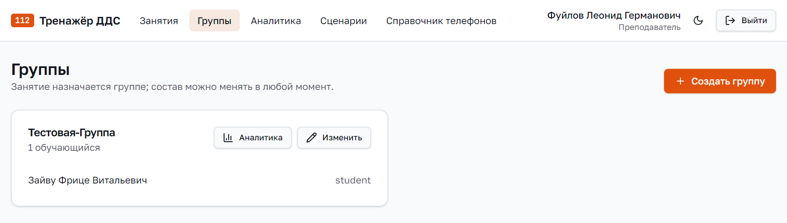
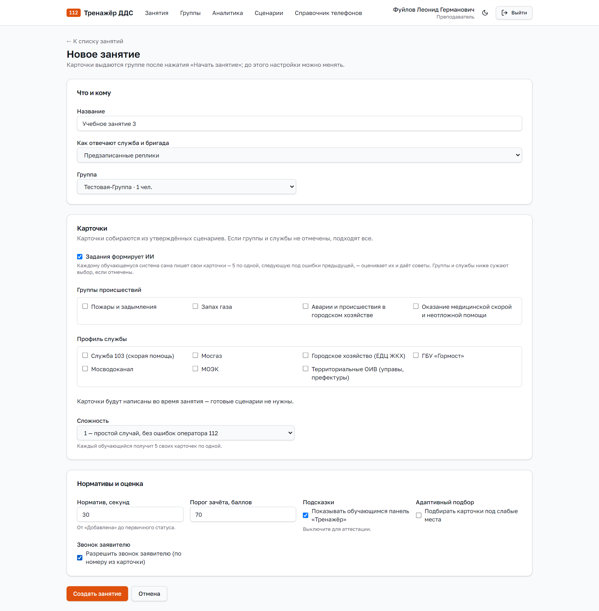
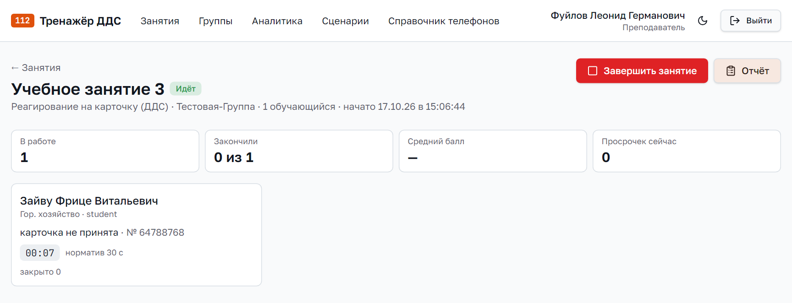
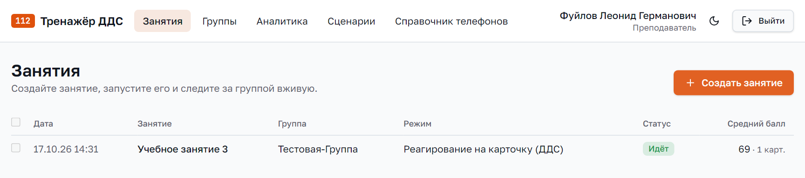
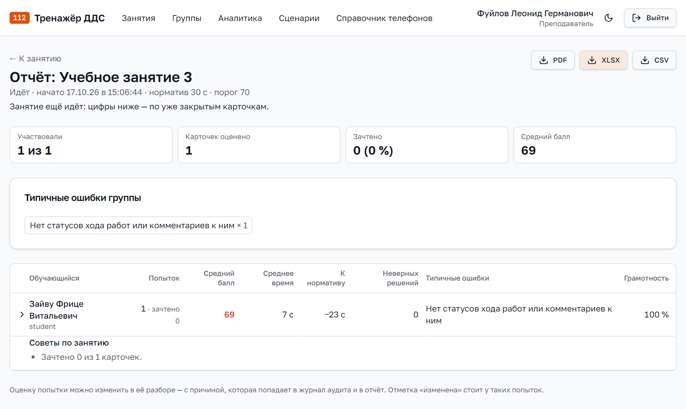
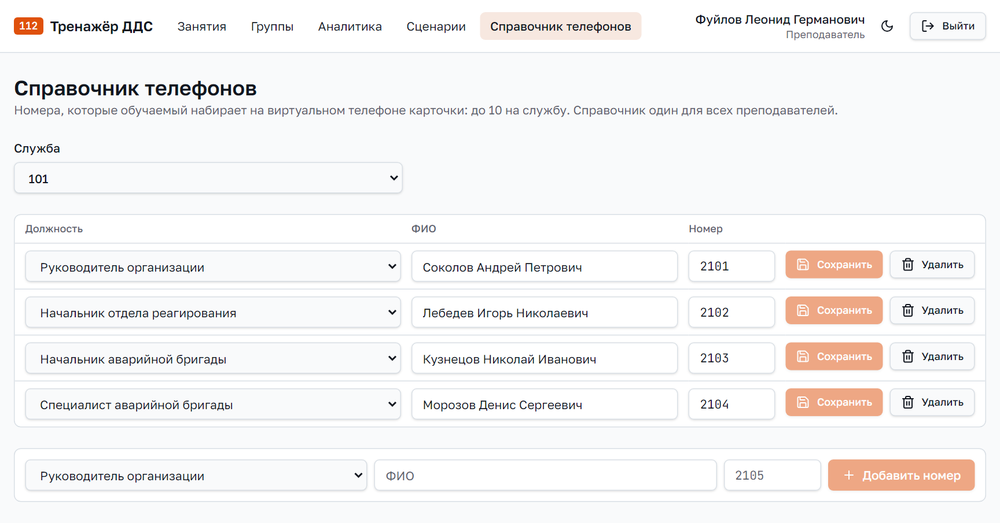
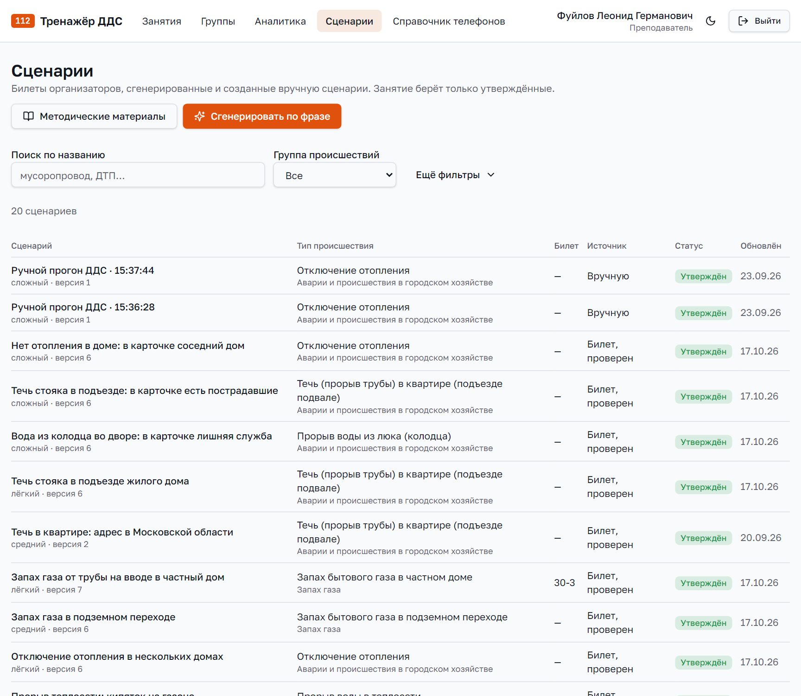
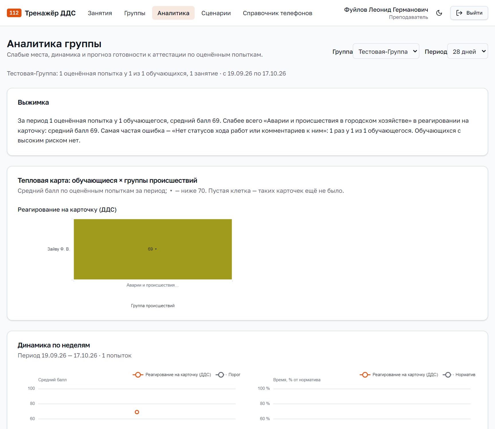

# Руководство преподавателя

## 1. Что делает преподаватель

Преподаватель готовит и проводит занятия диспетчеров ДДС:

- собирает обучаемых в группы;
- создаёт занятие: выбирает группу и сложность и запускает;
- во время занятия видит, что делает каждый обучаемый;
- после занятия смотрит отчёт, разборы и при необходимости исправляет оценку с причиной;
- ведёт справочник телефонов, учебные сценарии и методические материалы;
- следит за успехами группы и прогнозом готовности к аттестации.

Схема работы: **преподаватель и ИИ → обучаемый ДДС → результат → рекомендации для дальнейшего
обучения**. В режиме «Задания формирует ИИ» карточки каждому обучаемому пишет ИИ, он же
оценивает и даёт советы. Преподаватель запускает занятие и наблюдает.

## 2. Вход и меню

Откройте адрес системы, на странице «112 ВХОД В СИСТЕМУ» введите логин и пароль и нажмите
«ВОЙТИ». При первом входе система попросит сменить временный пароль.

Меню преподавателя сверху: «Занятия», «Группы», «Аналитика», «Сценарии», «Справочник
телефонов». Справа — имя,
переключатель светлой и тёмной темы, кнопка «Выйти».

## 3. Группы

Занятие всегда назначается группе. Состав группы можно менять в любой момент.

**Создать группу:**

1. «Группы» → «Создать группу».
2. Введите название, например «Учебная-3».
3. В списке «Состав» отметьте флажками обучаемых. Их заводит администратор.
4. Нажмите «Создать группу».

**Изменить группу:** кнопка «Изменить» на карточке группы. Добавить или убрать обучаемого —
поставить или снять флажок, затем «Сохранить группу».

Кнопка «Аналитика» на карточке группы открывает аналитику этой группы (раздел 10).

## 4. Создание занятия

«Занятия» → «Создать занятие». До нажатия «Начать занятие» все настройки можно менять.

### 4.1. Что и кому

- **Название** — например, «Реагирование ДДС управы, занятие 3».
- **Как отвечают служба и бригада** — как говорят собеседники по телефону:
  - «Предзаписанные реплики» — по умолчанию. Модель выбирает подходящую утверждённую реплику,
    звучит её запись. Работает быстро и без интернета;
  - «Свободная генерация речи (без интернета)» — модель сочиняет каждую реплику сама. Медленнее
    и менее предсказуемо;
  - «Свободная генерация речи (с интернетом)» — облачная модель с живым голосом. Есть только на
    демонстрационном стенде.
- **Группа** — кому назначено занятие. Если групп нет, сначала создайте группу.

### 4.2. Карточки и режим «Задания формирует ИИ»

Карточки берутся одним из двух способов.

**Задания формирует ИИ** — галочка вверху блока «Карточки». ИИ сам пишет каждому обучаемому его
собственные карточки: на сложностях 1 и 2 — пять штук, по одной, на сложности 3 — вал из трёх.
Каждая подбирается под ошибки обучаемого (на сложностях 1 и 2 следующая пишется после оценки
предыдущей, в вале — по уже закрытым карточкам):

- карточка не зачтена или пропущена ошибка оператора 112 — следующая из той же группы
  происшествий и снова с такой ошибкой;
- всё верно — следующая из группы, где у обучаемого самый низкий рейтинг или карточек ещё не было.

У разных обучаемых разные происшествия. ИИ оценивает каждую карточку и даёт советы, а в разборе
объясняет, почему выдал именно эту карточку. Готовые сценарии в этом режиме не нужны: под
галочкой написано «Карточки будут написаны во время занятия — готовые сценарии не нужны».
Отмеченные группы происшествий и службы сужают выбор ИИ.

На демонстрационном стенде карточки пишет облачная модель, у заказчика — модель на самом
сервере, без интернета. Если модель не ответила, карточка собирается по шаблону, и занятие идёт
дальше.

**Из готовых сценариев** — галочка снята. Карточки берутся из утверждённых сценариев (раздел 9).

- **Группы происшествий** и **Профиль службы** — какие происшествия и для каких служб брать.
  Если ничего не отмечено, подходят все. Списки показывают только то, для чего есть
  утверждённые сценарии.
- Ниже видно, сколько карточек подходит: «Доступно карточек: N». Если подходящих нет, занятие
  не начнётся — снимите отметки или утвердите сценарии.

### 4.3. Сложность

В списке «Сложность» уровни подписаны: «1 — простой случай, без ошибок оператора 112», «2 — одна
ошибка оператора 112 в карточке», «3 — ЧС, две ошибки, вал: 3 карточки по одной каждые 40–50 с».

| Сложность | Что получает обучаемый |
|---|---|
| 1 | Одна карточка. Простое бытовое происшествие, данные карточки верные, собеседники понятливые |
| 2 | Одна карточка. Сложнее: в карточке одна ошибка оператора 112, собеседник один раз путает данные |
| 3 | Вал карточек: первая сразу, дальше по одной каждые 40–50 с, всего 3 (повторный вызов входит в три). Чрезвычайные ситуации, две ошибки в карточке, собеседники торопят, бывают осложнения на месте |

Вал — это тренировка работы под нагрузкой. Отдельных настроек у него нет: он включается
сложностью 3, и в обычном занятии, и в режиме «Задания формирует ИИ» (там каждая карточка вала
написана для своего обучаемого, ИИ пишет их заранее, чтобы они приходили вовремя).

В обычном занятии в вале бывает повторный вызов о том же происшествии: он приходит через 1–2
минуты после исходной карточки и входит в три карточки вала. Верное решение по нему — «Не принята» с причиной «дубль». После вала у каждого обучаемого появляется сводка (раздел 6).

### 4.4. Нормативы и оценка

- **Норматив, секунд** — время от появления карточки в журнале до первичного статуса
  («Принята» или «Не принята»). По умолчанию 30 секунд.
- **Порог зачёта, баллов** — по умолчанию 70.
- **Подсказки** — «Показывать обучающимся панель «Тренажёр»» с подсказками. Для аттестации
  выключите.
- **Адаптивный подбор** — «Подбирать карточки под слабые места»: обучаемому чаще достаются
  происшествия, на которых он ошибался. В режиме «Задания формирует ИИ» галочка не действует:
  ИИ и так подбирает карточки под ошибки.
- **Звонок заявителю** — «Разрешить звонок заявителю (по номеру из карточки)». По умолчанию
  выключено: диспетчер ДДС с заявителем не говорит. Если включить, у обучаемых в справочнике
  телефона появится строка «Заявитель — номер из карточки», и они смогут позвонить заявителю.
  Подходит для бытовых случаев: мусор, животное в вентиляционной шахте, нет доступа в подъезд.

Нажмите «Создать занятие» — откроется страница занятия. В списке занятий оно со статусом
«Не начато».

## 5. Проведение занятия

### 5.1. Запуск

Откройте занятие. До запуска видны его настройки, список подходящих сценариев и состав группы.
Кнопка «Настройки» возвращает к форме.

Нажмите **«Начать занятие»**. Обучаемые получат карточки: у кого открыт журнал, увидят их сразу,
остальные — при входе.

### 5.2. Наблюдение

Пока занятие идёт, страница обновляется сама. Сверху сводка: «В работе», «Закончили»,
«Средний балл», «Просрочек сейчас».

Ниже — плитка на каждого обучаемого:

- что он делает: «ждёт карточку», «в работе», «все карточки закрыты»;
- этап: «смотрит карточку», «проставляет статус», «проверяет данные карточки», «звонит в
  службу»;
- номер карточки и таймер норматива;
- сколько карточек закрыто и зачтено, средний и последний балл.

Красная рамка — обучаемый не уложился в норматив или карточка «Не оповещено». Жёлтая — низкий
балл.

Щелчок по плитке открывает его текущую карточку: что уже сделано, статусы, данные карточки.
Кнопка «Обновить» показывает свежее состояние. Разбор с оценкой появится, когда обучаемый
закроет карточку.

### 5.3. Завершение

Нажмите **«Завершить занятие»** и подтвердите. Открытые карточки закроются и будут оценены как
есть.

## 6. Отчёт

Кнопка «Отчёт» на странице занятия. Отчёт можно открыть и во время занятия: тогда цифры — по уже
закрытым карточкам.

**Итоги:** сколько участвовало, сколько карточек оценено и зачтено, средний балл, типичные
ошибки группы.

**Таблица по обучаемым:** попытки и сколько зачтено, средний балл (красный — ниже порога),
среднее время, отставание от норматива, неверные решения, типичные ошибки, грамотность.

**Советы по занятию.** Под строкой каждого обучаемого — что у него повторялось, сколько ошибок
оператора 112 он нашёл, как менялся балл. Для обычных занятий со сложностью 3 там же сводка
«Вал карточек»: сколько карточек пришло и закрыто, сколько с опозданием, сколько без реакции,
взята ли ЧС первой. В выгрузку советы и сводка не попадают.

**Попытки.** Стрелка слева раскрывает строку обучаемого до отдельных карточек: тип, балл,
время, решение против эталона, ошибки. Колонка «Действия» показывает по шагам, что обучаемый
делал и когда: статусы с нарядом и комментарием, отметки ошибок в карточке, звонки. Ссылка
«Разбор» открывает разбор карточки.

**Выгрузка:** кнопки «PDF», «XLSX», «CSV». Каждая выгрузка записывается в журнал аудита.

## 7. Разбор карточки, комментарий и изменение оценки

Разбор открывается из отчёта или с плитки обучаемого. Преподаватель видит то же, что обучаемый:
итог, составляющие, советы для дальнейшего обучения, эталон против решения, типичные ошибки
со ссылкой на памятку, проверку
данных («Найдено ошибок: N из M»), звонки с записью и расшифровкой, комментарии с ошибками
грамотности.

**Комментарий обучаемому.** В блоке «Комментарии преподавателя» напишите, что учесть в
следующий раз, и нажмите «Отправить комментарий». Обучаемый увидит его в своём разборе.

**Изменить оценку.** Система ошибается, например, если распознавание речи не расслышало номер
наряда. Тогда:

1. Нажмите «Изменить оценку».
2. Введите «Новый итог» (0–100) и «Причину» — обязательно, хотя бы несколько слов.
3. Нажмите «Сохранить новую оценку».

Прежняя оценка остаётся в разборе зачёркнутой, рядом видно, кто, когда и почему изменил.
Изменение записывается в журнал аудита и отмечается в отчёте словом «изменена».

## 8. Справочник телефонов

У обучаемого в карточке есть виртуальный телефон (зелёный кружок). В его справочнике — номера
людей организации, которые задаёт преподаватель в меню «Справочник телефонов».

- Справочник ведётся по службам: выберите службу в поле «Служба». Обучаемый видит номера своей
  службы.
- У службы до 10 номеров. В каждой строке: «Должность», «ФИО», «Номер» из четырёх цифр,
  например 2101.
- Должность — одна из четырёх: «Руководитель организации», «Начальник отдела реагирования»,
  «Начальник аварийной бригады», «Специалист аварийной бригады». Как они отвечают обучаемому,
  описано в руководстве обучаемого, раздел 9.
- После установки у каждой службы уже есть четыре номера, по одному на каждую должность.
  Их можно менять.
- Справочник один для всех преподавателей. Каждое изменение записывается в журнал аудита.

**Добавить номер:** внизу выберите должность, введите ФИО и номер, нажмите «Добавить номер».
**Изменить:** поправьте строку и нажмите «Сохранить». **Удалить:** «Удалить» и подтверждение.
Номер не должен повторяться внутри службы.

Дежурных других служб в справочнике нет: им обучаемый звонит трубкой на вкладке службы в
карточке. Заявителю — только если в занятии включён «Звонок заявителю».

## 9. Сценарии и методические материалы

Сценарий — это учебная карточка вместе с эталоном: какое решение верное, какие статусы и в
каком порядке, номер наряда, какие звонки нужны и что в них передать, какие доклады бригады
придут. В занятия попадают только **утверждённые** сценарии.

В библиотеке уже есть 96 сценариев по учебным билетам заказчика.

**Найти сценарий:** «Поиск по названию» и фильтр «Группа происшествий». Фильтры «Источник»,
«Статус» и «Билет» открываются кнопкой «Ещё фильтры». Сценарии в архиве видны, если там выбрать
статус «В архиве».

**Создать по фразе:**

1. «Сгенерировать по фразе».
2. В поле «Что должно случиться» опишите ситуацию, например «засор мусоропровода в
   многоэтажном доме, жильцы жалуются на запах».
3. При желании выберите группу или тип происшествия и сложность.
4. Нажмите «Сгенерировать». Через одну-две минуты откроется черновик сценария.

**Проверить и утвердить черновик.** На странице сценария видно карточку так, как её увидит
диспетчер, заложенные ошибки оператора 112 и эталон.

- Красная плашка «Сценарий не пройдёт утверждение, пока не исправлено» — исправьте названное.
- «Проверить грамотность» — найдёт ошибки в текстах.
- Эталон и доклады бригады можно поправить кнопкой «Изменить».
- «Что исправить» и «Переделать» — напишите замечание, система сделает новую версию. Прежние
  версии сохраняются.
- «Утвердить целиком» — сценарий станет доступен занятиям.

Сценарии из билетов заказчика проверены и озвучены, их менять нельзя.

**Удалить.** Сценарий, по которому никто не занимался, удаляется совсем. Сценарий из прошлых
занятий уходит в архив, чтобы их разборы остались открытыми. Из архива его можно вернуть кнопкой
«Восстановить».

**Методические материалы.** Кнопка «Методические материалы» → «Загрузить документ» (PDF, DOCX,
TXT). Обучаемые читают их в «Справочнике» и находят поиском, а генерация учитывает их при
написании сценариев.

## 10. Аналитика и прогноз готовности

«Аналитика». Сверху выберите группу и период: 7, 14, 28 или 90 дней.

- **Выжимка** — главное о группе в нескольких предложениях.
- **Тепловая карта** «обучающиеся × группы происшествий» — у кого и на каких происшествиях
  балл ниже 70.
- **Динамика по неделям** — средний балл и время относительно норматива.
- **Типичные ошибки группы** — пять самых частых за период с объяснением.
- **Прогноз готовности к аттестации** — для каждого обучаемого вероятность сдать, оценка
  «Готов», «Под вопросом», «Риск» или «Нет данных» и объяснение, почему так.

Ссылка **«Достоверность прогноза»** показывает, насколько прогноз совпадает с фактом: качество
на отложенной выборке, калибровку и вес признаков, с объяснением простыми словами.

## 11. Частые вопросы

**Обучаемый не видит карточек.** Проверьте, что он в группе занятия, что занятие запущено и что
администратор указал ему службу. Если галочка «Задания формирует ИИ» снята, под настройки
занятия должны подходить утверждённые сценарии.

**Почему у обучаемых разные карточки?** В режиме «Задания формирует ИИ» каждому пишутся свои
карточки под его ошибки. Это и есть цель режима.

**Как провести аттестацию?** Создайте занятие с нужной сложностью и выключите подсказки.

**Можно ли удалить занятие?** Да, кроме идущего: «Занятия», отметьте занятия флажками,
«Удалить выбранные». Вместе с занятием безвозвратно удаляются его карточки, оценки, комментарии
и записи разговоров. Удаление записывается в журнал аудита.

**Почему оценка не такая, как я ожидал?** Откройте разбор: балл разложен по составляющим, каждая
ошибка объяснена. Если система ошиблась, измените оценку с причиной (раздел 7).

**Где памятка?** В разборе у каждой типичной ошибки есть ссылка «Памятка, …» с номером страницы
или другим источником: она открывает «Справочник» с поиском по этой ошибке.
